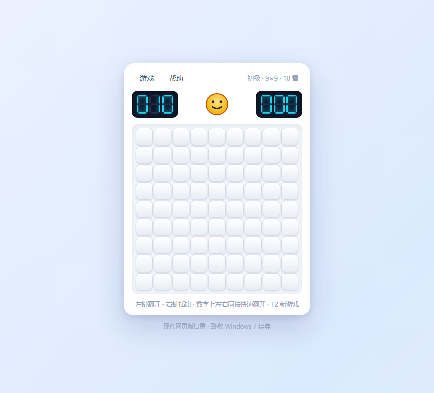

# 扫雷 - 现代网页版

经典扫雷的现代网页复刻：**圆角、渐变、流畅动画**。原生 HTML / CSS / JavaScript 实现，零依赖、零构建。

## 运行

直接双击 `index.html`（`file://` 协议即可），或将整个 `web/` 目录部署到任意静态托管（GitHub Pages、Nginx、对象存储等）——无需构建、无需服务端。

> 建议桌面浏览器（鼠标操作：左键翻开、右键插旗、左右同按快速翻开）。触屏设备可玩基础操作（点按翻开），长按插旗暂未实现。

内置自测：浏览器打开 `index.html?test=1`，页面标题显示 `TEST-ALL-PASS-n` 即全部通过（无头浏览器 CI 可用）。

## 文件结构

| 文件 | 说明 |
|------|------|
| `index.html` | 页面结构：菜单栏、LED 计数器、笑脸、棋盘、两个对话框 |
| `style.css` | 全部样式与动画（圆角卡片、渐变格子、波浪/弹跳/爆炸关键帧） |
| `game.js` | 游戏逻辑 + 界面胶水；上半部分为纯逻辑，可在 Node 下测试 |
| `tests/logic.test.cjs` | 纯逻辑单元测试（`node tests/logic.test.cjs`） |
| `preview.png` | 无头浏览器渲染的预览图 |

## 玩法与操作

| 操作 | 功能 |
|------|------|
| 左键单击 | 翻开格子 |
| 右键单击 | 插旗 / 取消旗子 |
| 左右键同按（在已翻开的数字上） | 快速翻开周围（Chord） |
| 笑脸按钮 / `F2` / 菜单「游戏 → 新游戏」 | 重新开始 |
| `Esc` | 关闭菜单 / 对话框 |

顶部面板：左侧 LED = 剩余雷数（下限 -99），右侧 LED = 用时（秒，上限 999）。

## 功能特性

- 三种预设难度 + **自定义难度**（行 5–40、列 5–60、任意雷数，校验规则与原版一致）
- 首次点击保证安全（点击处及其周围 8 格不放雷），洪泛展开
- **动画**：
  - 翻开**波浪扩散**（按 BFS 距离错峰弹出，14ms/级）
  - 插旗 / 取消**弹性弹跳**（120ms 回弹曲线）
  - 踩雷后**逐颗爆炸**（35ms 错峰缩放爆开）+ 死格红底抖动 + 整板震动
  - 胜利**自动插旗**（30ms 错峰弹跳）+ 笑脸戴墨镜弹跳
  - 背景渐变缓慢漂移、卡片入场动画、菜单/对话框弹性过渡
- 七段数码管 LED 计数器（SVG 段位 + 辉光）、SVG 表情笑脸（普通/惊讶/失败/墨镜）
- 失败显示所有地雷、错旗打红叉、踩中的雷标红；胜利自动插满旗
- 棋盘自适应窗口尺寸（18–34px 格子），高分屏清晰

## 与原版的关系

本项目仓库共三个版本：Win32 原版（根目录）、Qt 6 像素级还原版（[`../qt/`](../qt/README.md)）、本网页版。网页版是**现代风格重设计**（非像素还原）：圆角格子、柔和渐变、弹性动画；玩法规则与原版一致。
