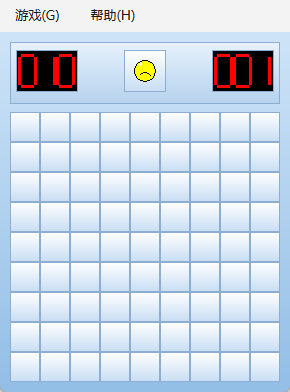
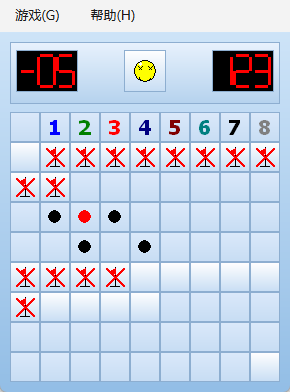
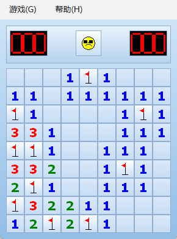
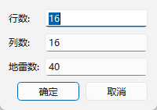

# 扫雷开发续篇：用 Qt 6 重写，把像素还原度做到 0 差异

> 上一篇《用 C++ 和 Win32 从零写一个扫雷》讲的是"怎么做出来"；这一篇讲的是"怎么搬过去"——把同一个扫雷用 Qt 6 重构，并把还原度做到**逐像素 0 差异**。
> 前篇见：`扫雷游戏开发博客.md`。本篇对应的完整代码在项目 `qt/` 目录。

---

## 一、背景与目标：什么叫"还原"

前篇的成品是一个纯 Win32 + GDI 的扫雷，Windows 7 蓝色 Aero 风格：渐变背景、七段数码管计数器、光泽格子、波浪翻开动画、爆炸散开的雷区。这次的任务是用 Qt 6 重构它，而且要求明确：

1. **视觉完全还原**——不是"差不多像"，是像素级一致；
2. **动画全部保留**——翻开波浪、插旗弹跳、胜利自动插旗、失败逐雷爆炸；
3. 原版 Win32 工程**原地保留**，Qt 工程放进 `qt/` 子目录。

"视觉完全还原"这条要求，把一个普通的 GUI 移植项目变成了一个**逆向渲染语义**的工程问题。因为 Qt 和 GDI 是两个完全不同的绘制引擎：渐变的插值方式不同、直线的栅格化规则不同、椭圆的轮廓不同、文字的字形更不可能相同。要在 Qt 里画出和 GDI 一模一样的像素，光靠 QPainter 的高层 API 是不够的。

我们的验收标准也很硬核：**写了一个逐像素对比流水线**，把原版 exe 和 Qt 版 exe 的窗口截图按像素相减，最终棋盘区域差异为 **0**。



---

## 二、架构映射：四个模块各就各位

原版是四模块架构（前篇第二节），Qt 版的映射很自然：

| 原版（Win32） | Qt 版 | 变化 |
|---|---|---|
| `app.cpp`：WinMain、消息循环、菜单、定时器 | `mainwindow.cpp` + `main.cpp` | 消息循环交给 QApplication；`WM_TIMER` → 两个 QTimer（1000ms 计时 / 16ms 动画）；菜单 → QMenuBar |
| `render.cpp`：全部 GDI 绘制 + 动画 | `boardwidget.cpp` | `HDC` → QPainter；双缓冲由 Qt 接管；静态布局函数（boardSize/cellRect 等）原样保留 |
| `dialogs.cpp`：手工写的内存对话框模板 | `customdialog.cpp` | → QDialog + 3 个 QLineEdit |
| `game.h / game.cpp`：核心逻辑 | `game.h / game.cpp` | **几乎原样保留**，只去掉 `windows.h`，把 `GetTickCount()` 换成 `std::chrono::steady_clock` |

最舒服的部分是核心逻辑层：前篇坚持的"逻辑与渲染彻底解耦"这次直接兑现了红利——`Game` 类不知道像素、颜色、HDC，也不该知道 QPainter，于是**一行逻辑代码都没改**就搬了过来。

```cpp
// game.cpp 里唯一的环境适配：计时改用标准库
unsigned NowMs() {
    return (unsigned)std::chrono::duration_cast<std::chrono::milliseconds>(
        std::chrono::steady_clock::now().time_since_epoch()).count();
}
```

渲染层则是重灾区。`render.cpp` 里每一笔都是 GDI 调出来的，搬进 QPainter 的第一版跑起来"看起来差不多"，但截图一对比，到处都是差几个色阶的渐变、错一两个像素的旗子、粗细不同的数字。下面按难度顺序讲三个坎。

---

## 三、第一个坎：逆向 GDI 渐变的插值公式

背景、格子、面板、翻开格全部是垂直渐变（`GradientFill` 的 GRADIENT_FILL_RECT）。先用 `QLinearGradient` 试：

```cpp
QLinearGradient g(0, 0, 0, h);
g.setColorAt(0, top);
g.setColorAt(1, bottom);
```

结果整板都不对——某些行的颜色差 1。差 1 在渐变里几乎看不出来，但在逐像素对比里就是几万个差异。

于是换成"取证"思路：把原版窗口截图下来，用 Pillow 读取每一行渐变的 RGB 值，然后猜 GDI 的定点插值公式。GDI 的 `GradientFill` 文档并不保证具体算法，但实测数据把候选公式一个个枪毙了：

- **截断** `v = top + trunc(delta * y / h)`：错。背景渐变第 20 行 b 通道必须得到 246，截断给 247；
- **四舍五入 / 向上取整**：同样给 247，错；
- **步进累加**（每行加一个定点增量再舍入）：个别行差 1，错。

最终命中的公式（对背景/格子/面板/翻开格四组共 **1458 个样本验证 0 差异**）：

```
v = top + floor(delta * (y * 65536 + h - 1) / (h * 65536))
```

它等价于把行号 `y` 先向上偏置 `(h-1)/65536` 再向下取整——这个微小的偏置在负斜率（delta 为负）下会改变舍入结果，正是第 20 行差 1 的原因。落实到代码：

```cpp
// qt/src/boardwidget.cpp —— GDI GradientFill 的等价实现
int gradStep(int top, int bot, int y, int h) {
    if (y == 0) return top;                       // 首行恒等于 top
    qint64 num = qint64(bot - top) * (qint64(y) * 65536 + h - 1);
    qint64 den = qint64(h) * 65536;
    qint64 q = num / den, r = num % den;
    if (r < 0) --q;                               // C++ 除法向零取整 → 手动补成 floor
    return top + int(q);
}

void fillGradientV(QPainter& p, const QRect& rc, const QColor& top, const QColor& bottom) {
    for (int y = 0; y < rc.height(); ++y)         // 逐行 fillRect，各通道独立算
        p.fillRect(rc.left(), rc.top() + y, rc.width(), 1,
                   QColor(gradStep(top.red(),   bottom.red(),   y, rc.height()),
                          gradStep(top.green(), bottom.green(), y, rc.height()),
                          gradStep(top.blue(),  bottom.blue(),  y, rc.height())));
}
```

板子总共几百行，逐行填充的性能完全不是问题；像素一致才是。

---

## 四、第二个坎：GDI 的栅格化语义，差一个像素都不行

渐变对了之后，差异集中到了线条图形上。逐个排查后发现，GDI 有一组**不会写在文档里、但忠实反映在像素里**的栅格化规则：

| 原语 | GDI 规则 | Qt 默认行为 |
|---|---|---|
| `LineTo` | **不含终点像素**（一条从 (0,0) 到 (0,10) 的线实际画 y=0..9） | `drawLine` 含两端点 |
| `Polygon` 填充 | 扫描线填充**含左、底边，排除顶、右边** | QPainterPath 填充规则不同 |
| `Ellipse` | 边界矩形按 RECT 语义**右、下排他** | 椭圆轮廓算法不同，半径处的轮廓像素不一致 |
| `FrameRect` / RECT | 所有 RECT 的 right/bottom 都是**排他**坐标 | QRect 的 right()/bottom() 是含端坐标 |

这些差异每处只差 1 个像素，但棋盘的旗子、底座、红叉、雷都是几像素到十几像素的小图形，差 1 就占 10%。

以旗子为例，原版 `DrawFlag` 的语义拆解出来是这样的（格内坐标，格子左上角 (left, top)）：

- 中轴 `cx = (left + right) / 2`，其中 right 是**排他**右边界，所以 30px 格的 `cx = 25` 而不是 24；
- 旗杆 `MoveTo(cx, top+5)` → `LineTo(cx, bottom-5)`，不含终点，实际画到 `bottom-6`；
- 三角 `Polygon{(cx+1, top+5), (cx+1, top+13), (cx-6, top+9)}`，填充含左/底边、排除顶/右边。

Qt 版不用 `drawPolygon` 猜行为，而是**逐行算出扫描线区间直接 fillRect**，把 GDI 语义变成显式算术：

```cpp
// qt/src/boardwidget.cpp —— 旗子按 GDI 扫描线语义逐行复现
int top = rc.top() + 5, bot = rc.top() + rc.height() - 5;
int cx  = rc.left() + rc.width() / 2;            // 排他中心 = 25
p.drawLine(cx, top, cx, bot - 1);                // LineTo 不含终点 → 手动 -1
p.drawLine(cx - 5, bot - 1, cx + 4, bot - 1);    // 底座，右端同样 -1
for (int yy = top + 1; yy <= top + 7; ++yy) {    // 三角：逐行求左缘
    double lx = (yy <= top + 4)
        ? (cx + 1) - 7.0 * (yy - top) / 4.0
        : (cx - 6) + 7.0 * (yy - (top + 4)) / 4.0;
    int x0 = int(std::ceil(lx));
    p.fillRect(x0, yy, cx + 1 - x0, 1, QColor(255, 0, 0));
}
```

用"格内坐标 + 扫描线区间"而不是"端点坐标 + 多边形"来思考，GDI 的每一条隐式规则都能变成一行显式代码。旗子修完后，整板插旗棋盘 104400 像素差异清零。

---

## 五、第三个坎：画不出来的，就"烘焙"

线条可以靠算术复现，但有两类东西**根本不可能**用 QPainter 画出一致的像素：

1. **数字字形**：原版用 `DrawText` + Tahoma 20px bold（ClearType 抗锯齿 + GDI 自己的字距/微调），Qt 的文本引擎是另一套，字形、基线、抗锯齿像素全都不同；
2. **地雷椭圆**：GDI 的 `Ellipse` 栅格化结果（半径 2..7 的 12 种小椭圆），Qt 的椭圆算法画不出相同的轮廓像素。

既然画不出来，那就让**原版 GDI 自己画好，我们直接贴图**。做法：

- 写一个离线渲染器 `harness2.cpp`：`#include` 原版的 `render.cpp`，在离屏位图（32bpp top-down DIB）上调用原版内部函数，把数字 1–8（30×30 整格合成：渐变+边框+字形）、黑雷/红雷（R=2..7，14×14）、错旗红叉（30×30）逐一画成 BMP；
- 一个 Python 脚本把这些 BMP 转成 C++ 头文件 `cellpix.h`（约 140KB），背景哨兵色 → alpha 0；
- Qt 侧把数组包成 `QImage`（不拷贝数据，`reinterpret_cast` 外接内存），绘制时直接 `drawImage` blit。

```cpp
// qt/src/boardwidget.cpp —— 地雷直接贴 GDI 烘焙图
void drawMine(QPainter& p, const QRect& rc, bool red, float s) {
    int R = int(7.0f * s);                       // 原版：R = int(7 * s)，R < 1 不画
    if (R < 1) return;
    int cx = rc.left() + rc.width() / 2, cy = rc.top() + rc.height() / 2;
    const QImage& img = mineImage(red, R);       // 14x14，中心即圆心
    p.drawImage(QRect(cx - R, cy - R, 2 * R, 2 * R),
                img, QRect(7 - R, 7 - R, 2 * R, 2 * R));
}
```

注意 `cx` 用的是排他中心——它不随缩放动画改变，永远是格内 (25, 95)，所以弹开动画的任意中间帧都能从烘焙图中心裁一个 `2R×2R` 的窗口，与原版 `ScaleRect` 的中心缩放语义完全一致。

笑脸和计数器同理：笑脸的三种表情（正常/惊讶/墨镜）是从原版 `DrawSmiley` 离屏烘焙的 42×42 图；七段数码管因为本来就是矩形拼出来的，QPainter 直接复刻即可，不需要烘焙。

---

## 六、验证流水线：地面真相 + 逐像素 diff

"看起来对了"没有任何说服力，我们需要**可重复的、自动化的对比**：

1. **地面真相**：`harness2.cpp` 用原版 GDI 代码离屏渲染整块棋盘（背景+头部+81 格），存为 290×360 的 BMP；
2. **固定棋局**：给 Qt 版加了 `--demo-cells <kind>` 演示参数（以及 `Game::InjectState` 测试注入），让两版渲染**完全相同的棋盘状态**（雷的位置、错旗位置、计时、计数都钉死）；
3. **截图**：Python 脚本（win32 + Pillow）找到窗口句柄、`GetClientRect` + `ClientToScreen` + `BitBlt` 截取客户区（Qt 版菜单栏占客户区 32px，对比时把板区按偏移对齐）；
4. **diff**：numpy 逐像素相减，输出差异坐标与颜色。

最终结果：

| 场景 | 对比像素数 | 差异像素 |
|---|---|---|
| 初始棋盘整板 | 104,400 | **0** |
| 插旗棋盘整板 | 104,400 | **0** |
| 失败棋局（错旗红叉、黑雷、踩中红雷、数字 0–8） | 104,400 | **0** |
| 胜利棋局 ×2（墨镜笑脸、计数器 789/46） | 104,400 | **0** |
| 胜利笑脸单图 | 1,764 | **0** |

唯一被排除的是窗口**左下/右下 DWM 圆角**约 8px 的圆弧——那是 Windows 窗口框架裁出来的，原版窗口截图同位置像素完全相同（见下文坑 3）。



---

## 七、三个真实的坑

### 坑 1：烘焙图的"透明底"是不透明黑

数字烘焙图第一次上板，结果**整个棋盘下半部分全黑**。逐格差异计数给出关键线索：每个旗子格差异 776 = 900 − 124（旗杆+底座+三角+红叉恰好约 124 个匹配像素），每个雷格差异 75 = 196 − 121（14×14 方块减去椭圆约 121 个匹配像素）——**前景都对，背景全黑**。

根因在离屏渲染器：为了把画布内容偏移到目标区域，我用了 `SetViewportOrgEx(ox, oy)`，而背景填充用的 `FillRect` 走的是**设备坐标**——视口原点一偏移，`{0,0,w,h}` 被映射到页面坐标后落在位图之外，整块被裁剪，哨兵色根本没填进去，背景留下纯黑；Python 端检测不到哨兵色，alpha 就设成了 255。修复是在 `FillRect` 前临时把视口原点复位成 (0,0)：

```cpp
SetViewportOrgEx(dc, 0, 0, &old);   // FillRect 走设备坐标，必须先复位
FillRect(dc, &rc, brush);
SetViewportOrgEx(dc, ox, oy, &old); // 其余 GDI 调用仍需要偏移
```

### 坑 2：幽灵黑雷

修复坑 1 后重跑，胜利棋盘还有 641 个差异——集中在三个格子里，原版 BMP 上凭空出现了**黑雷椭圆**。定位到棋盘解析函数：三种棋局共用同一块内存数组，解析每局前**忘记把格子重置**，而"已翻开空格"的字符分支只设置 `revealed` 和 `adj`、不清 `mine`——于是上一局（失败局）的 `mine = true` 泄漏到了下一局（胜利局）。一行修复：

```cpp
for (each cell) {
    TestCell c = TestCell();   // ← 少了这一行，上一局的雷就"复活"了
    switch (ch) { ... }
}
```

这个 bug 好在被像素对比抓了个正着——肉眼根本不会去怀疑"多出来的三个黑椭圆"。

### 坑 3：怎么都消不掉的 36 个差异

棋盘修到全零之后，重拍整板截图，**三个棋局稳定地各剩 36 个差异**，全在板子底边左右两个角上。先怀疑任务栏遮挡，加了窗口移动+聚焦重拍，36 个差异纹丝不动；再把三张不同棋局的 Qt 截图底角像素拿出来对比——**完全相同**；最后检查原版窗口截图同一位置——**弧度完全一致**。结论：Windows 11 的 DWM 会把窗口客户区底角裁成圆角（半径约 8px），两版真实窗口同样被裁，而离屏渲染的 BMP 是方角。这不是渲染差异，是窗口框架差异。对比脚本最终给底角圆弧加掩码排除，并打印"窗口圆角区 36 已排除"。

（附带一个小坑：这套 Qt 6.12 llvm-mingw 套件的 `windeployqt` 在本机会报 "Unable to find the platform plugin."，部署脚本退化成手动拷贝 `platforms/`、`styles/`、运行时 DLL——不影响交付。）

---

## 八、结果与两处有意差异




最终交付的 Qt 版与原版**游戏区域逐像素一致**，动画（波浪翻开、插旗弹跳、爆炸逐雷、胜利自动插旗）全部按原版时间戳保留。有两处**有意**的差异，也记录在 README 里：

1. **菜单栏**：原版菜单是 Windows 原生非客户区菜单；Qt 版 QMenuBar 在客户区内，窗口总高多出一条菜单栏——棋盘本体仍是 1:1；
2. **关于对话框**：文案标注改为 "C++ / Qt 实现"。

---

## 结语

这个项目最有意思的部分，不是"用 Qt 写了个扫雷"，而是**把"还原度"当成第一需求之后，浮现出来的那些问题**：GDI 的渐变公式、LineTo 的终点归属、Polygon 的扫描线规则、字形的像素级差异。这些规则大多没有写在任何文档里，但每一个都真实地存在于像素里——只要有一张地面真相截图和一个逐像素 diff 脚本，它们就无所遁形。

完整代码、构建脚本、烘焙与验证工具链都在项目里：`qt/src/`（Qt 源码）、`qt/shot/`（地面真相渲染器、烘焙脚本、截图对比脚本）、`qt/build-qt.bat`（一键构建+部署）。
